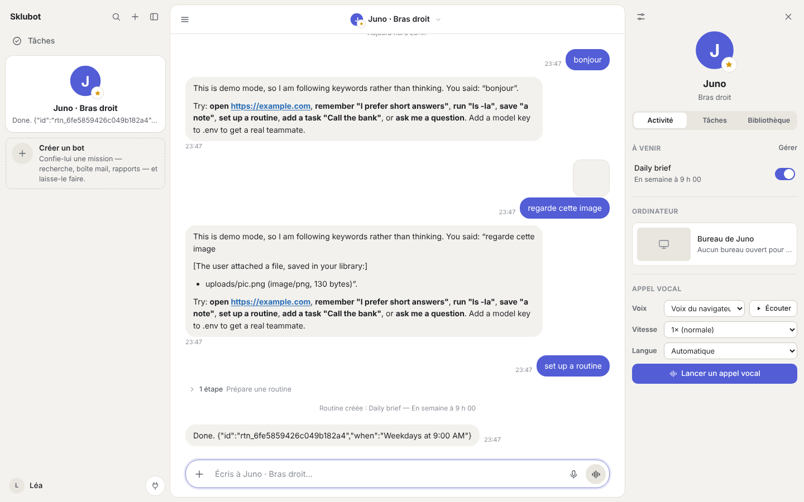

# Sklubot

Une équipe de bots IA auto-hébergée. Chaque bot a un nom, un rôle, sa mémoire, ses compétences, son
**propre ordinateur Linux**, ses fichiers, ses routines — et ils travaillent ensemble. Tout tourne sur ta machine,
avec tes clés ; les données restent dans un fichier SQLite local.

Sklubot a été reconstruit **en salle blanche** : voir [docs/CLEANROOM.md](docs/CLEANROOM.md).



## Ce que ça fait

| Domaine | Fonctions |
|---|---|
| **Bots** | Nom, rôle, description, consignes permanentes, avatar (12 formes × 11 couleurs), mode assistant personnel ou coéquipier, bot principal, niveau de réflexion, **modèle au choix par bot**, niveau d'autonomie |
| **Discussion** | Réponses en direct, étapes d'outils repliables, sources web, cartes d'approbation / de question / de connexion, envoi pendant que le bot travaille (le message rejoint le tour en cours), arrêt, nouvelle conversation |
| **Ordinateur** | **Un ordinateur Linux par bot** (conteneur isolé) : bureau graphique, navigateur Chromium, terminal, gestionnaire de fichiers, shell root, installation de logiciels ; tout est conservé entre les conversations ; **mise en veille automatique et réveil à la demande** ; capture, clic, saisie, touches, défilement, glisser ; bibliothèque de fichiers téléchargeables ; **vue en direct et prise de contrôle** depuis l'interface |
| **Applications** | **Catalogue d'applications à ajouter en une étape** (GitHub, Stripe, Hugging Face, documentation technique…) et tout serveur d'outils au standard ouvert MCP (URL + jeton). Lectures automatiques, écritures soumises à approbation, « toujours autoriser » mémorisé et révocable |
| **Coffre** | Identifiants enregistrés et chiffrés ; le bot les saisit sur son ordinateur **sans jamais voir le mot de passe**, après ton accord ; tout ce qui revient vers le modèle est nettoyé |
| **Fichiers et images** | Pièces jointes dans la discussion (le bot voit les images, les autres fichiers arrivent sur son ordinateur), envoi de fichiers par le bot, **génération d'images** |
| **Langue** | Interface, textes du serveur et réponses des bots en **français ou en anglais** |
| **Téléphone** | Version mobile installable sur l'écran d'accueil (iPhone, iPad) et **application Android (APK)** à télécharger depuis ton serveur |
| **Mise en ligne** | **Installation sur un VPS en une commande** (Docker, HTTPS automatique, mises à jour, sauvegarde) — voir [docs/INSTALLATION-VPS.md](docs/INSTALLATION-VPS.md) ; ou Coolify — voir [docs/DEPLOIEMENT.md](docs/DEPLOIEMENT.md) |
| **Mémoire** | Souvenirs enregistrés par le bot, **apprentissage automatique** après les conversations (avec dédoublonnage), sélection des souvenirs pertinents à chaque tour, **résumé automatique** des longues conversations |
| **Compétences** | Procédures rédigées par toi, injectées dans le bot |
| **Automatisation** | Routines créées en discutant : planifiées (cron + fuseau), ponctuelles, ou **déclenchées par webhook** ; points réguliers proactifs du bot principal |
| **Équipe** | Messages entre bots, assistants temporaires en parallèle (4 max, compte rendu automatique), discussions de groupe avec @mentions |
| **Tâches** | Suivi du travail en cours, en attente de toi, terminé |
| **Voix** | Appel vocal et dictée dans le navigateur (reconnaissance et synthèse vocales du navigateur), voix / vitesse / langue par bot |
| **Maîtrise** | Compteur de jetons et de coût par bot, **budget mensuel** qui met les bots en pause, garde-fou contre les boucles, limite d'étapes |

## Démarrage

Il te faut **Node.js 22.13 ou plus récent**.

```bash
npm install
cp .env.example .env        # puis remplis SESSION_SECRET et ANTHROPIC_API_KEY
npm run build
npm start                   # http://localhost:8787
```

**Essayer sans clé ni coût** : mets `DEMO_MODE=1` dans `.env` (sans clé de modèle). Un faux modèle qui suit
des mots-clés permet de parcourir toute l'application : outils, approbations, cartes, routines, navigateur.

Le premier compte créé est le tien ; les inscriptions se ferment ensuite (sauf `OPEN_SIGNUP=1`).

### L'ordinateur Linux de chaque bot

Il te faut **Docker** sur la machine qui héberge Sklubot. Construis l'image du bureau une fois (quelques minutes) :

```bash
npm run computer:build
```

Au démarrage, Sklubot affiche `Computers: a Linux desktop per bot`. Chaque bot reçoit alors son propre
conteneur à la première utilisation : Debian, bureau graphique 1280×800, Chromium, terminal, Python, Node.
Son dossier personnel est conservé (logiciels installés, connexions du navigateur, fichiers). Le dossier
`~/files` de l'ordinateur est la bibliothèque visible dans l'interface. Un ordinateur inactif depuis 20 minutes
s'endort ; il se réveille tout seul. Quatre ordinateurs peuvent être éveillés en même temps (`MAX_DESKTOPS`),
avec 2 Go de mémoire et 2 processeurs chacun (`DESKTOP_MEMORY`, `DESKTOP_CPUS`).

Sans Docker, Sklubot se rabat sur un simple navigateur par bot (`npm i playwright && npx playwright install chromium`),
et sinon sur la lecture de pages, la ligne de commande et les connecteurs.

### Développement

```bash
npm run dev -w server       # API sur le port 8787
npm run dev -w web          # interface sur http://localhost:5173
npm test                    # tests de bout en bout (modèle simulé, navigateur réel, connecteur réel)
npm run typecheck
```

### Génération d'images

Elle s'active dès qu'une clé `OPENAI_API_KEY` ou `XAI_API_KEY` est présente, ou avec `IMAGE_API_KEY` /
`IMAGE_BASE_URL` / `IMAGE_MODEL` pour tout service compatible. Les noms de modèles par défaut
(`gpt-image-1`, `grok-2-image`) n'ont pas pu être essayés ici : ajuste `IMAGE_MODEL` si ton fournisseur en attend un autre.

## Sécurité — à lire

- **Avec les ordinateurs Linux**, les commandes d'un bot s'exécutent dans son conteneur, pas sur ton serveur :
  il n'y voit ni tes clés ni tes fichiers, et n'a donc pas besoin de demander avant chaque commande.
  Le conteneur a accès à Internet et **peut joindre les services réseau de la machine hôte** (dont Sklubot
  lui-même) : n'héberge rien de sensible sans mot de passe sur cette machine.
- **Sans Docker**, la ligne de commande s'exécute sur la machine hôte, dans le dossier du bot, avec un
  environnement vidé ; un bot « prudent » demande alors ton accord avant chaque commande. Tu peux couper
  l'outil avec `SHELL_ENABLED=0`.
- Trois niveaux d'autonomie par bot : **prudent** (demande avant les commandes et les écritures dans les
  applications), **équilibré** (demande seulement avant les écritures dans les applications), **confiance**
  (ne demande jamais).
- Les jetons des connecteurs sont chiffrés dans la base et ne sont jamais renvoyés au navigateur ni au modèle.
- Les mots de passe sont hachés (scrypt) ; seules les empreintes des sessions sont stockées.
- Mets `PUBLIC_URL` en `https://…` si tu exposes le serveur, et place-le derrière un proxy TLS.

## Organisation

```text
server/src/llm/        fournisseurs de modèles (Claude, compatible OpenAI/xAI)
server/src/agent/      boucle d'agent, outils, mémoire, équipe, prompt
server/src/            base, routes HTTP, ordinateur, connecteurs, planificateur, usage
docker/desktop/        image de l'ordinateur Linux des bots
android/               application Android
Dockerfile.production, docker-compose.coolify.yml   mise en ligne
server/test/           tests de bout en bout
web/src/               interface React
docs/API.md            référence de l'API
docs/cleanroom/        cahiers des charges fonctionnels issus de l'étude
```

## Limites connues

- Le fournisseur Claude est écrit d'après la documentation officielle du SDK et compile, mais **n'a pas pu être
  essayé avec une vraie clé** dans l'environnement de construction ; les tests utilisent un modèle simulé.
- Voir aussi la section « Écarts » de [docs/CLEANROOM.md](docs/CLEANROOM.md).

## Licence

MIT.
