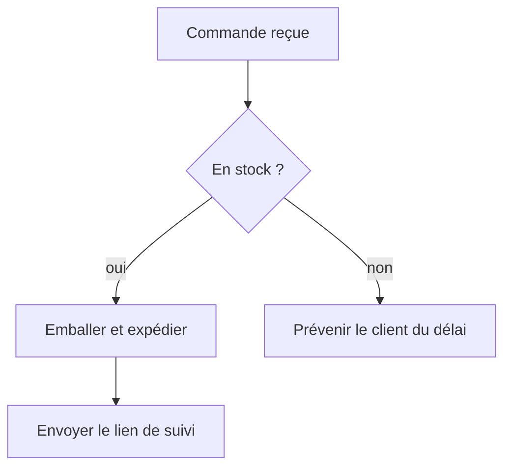

> Adaptée de CLI-Anything « cli-anything-mermaid » et « cli-anything-drawio » (© 2026 HKUDS CLI-Anything Team, Apache License 2.0). Modifiée pour Sklubot (22/11/2026) : les outils Python et le service de rendu en ligne mermaid.ink retirés (le contenu du schéma serait envoyé à un tiers) ; schémas dessinés dans les pages Sklubot ou rendus sur l'ordinateur du bot ; fichiers draw.io écrits directement ; traduite en français. Mise à jour le 25/11/2026 (L115) : les outils viennent avec l'image de l'ordinateur (page_audit, sklubot-axe, mmdc).

# Diagrammes

Un schéma vaut le coup quand il montre une structure plus vite qu'une liste : des étapes avec des choix, qui dépend de qui, ce qui se passe quand. Garde une seule idée, une quinzaine de cases au plus ; sinon coupe-le en deux.

## Choisir le type

- **Processus / décision** : Mermaid `flowchart TD` (de haut en bas) ou `LR` (de gauche à droite).
- **Qui parle à qui au fil du temps** (client, boutique, fournisseur) : `sequenceDiagram`.
- **Frise / planning** : `timeline` ou `gantt`.
- **Organigramme ou carte mentale** : `flowchart TD` ou `mindmap`.
- **Parcours client** : `journey`.
- **Une disposition que le patron veut réarranger à la main** : un fichier draw.io.

## Du Mermaid bien écrit

- Des étiquettes courtes (3 à 5 mots), la même forme de verbe partout, des identifiants sans espaces.
- Les décisions en `{question ?}` avec des flèches oui/non nommées.
- Pas de couleur sans signification ; si tu colores, ajoute une ligne de légende.
- Le texte dans la langue du patron ; les accents passent entre crochets.

## Le montrer

- **Dans une page ou un artefact Sklubot** (le mieux, reste modifiable) : charge la bibliothèque Mermaid depuis un CDN autorisé à une version exacte, par exemple ``, mets le texte dans `<pre class="mermaid">…</pre>`, appelle `mermaid.initialize({ startOnLoad: true, theme: "neutral" })`, et garde aussi le texte Mermaid sous le dessin (un bloc « Source ») pour pouvoir le modifier. Vérifie en clair, en sombre et en largeur téléphone (screen_view).
- **En fichier image** (pour un document, une diapo ou un e-mail) : rends-le sur ton ordinateur avec l'outil de rendu en ligne de commande de Mermaid, `@mermaid-js/mermaid-cli`, déjà installé sur ton ordinateur à une version figée (il utilise le Chromium de l'ordinateur, rien ne part en ligne) : `mmdc -i schema.mmd -o schema.svg` (ou `.png -s 2` pour une image nette) et regarde le résultat.
- **Jamais** coller le schéma dans un service de rendu en ligne (il recevrait le contenu).

## Fichier draw.io

Quand le patron veut déplacer les cases à la main, écris un fichier `.drawio` (du XML simple : `<mxfile><diagram><mxGraphModel><root>` avec des `mxCell` pour les cases avec `vertex="1"` et une `geometry`, et des flèches avec `edge="1" source="…" target="…"`), enregistre-le dans ta bibliothèque (file_save) et dis qu'il s'ouvre dans l'application gratuite draw.io ou sur app.diagrams.net (qui modifie les fichiers localement dans le navigateur). Garde des identifiants stables pour faciliter les modifications.

## Vérifier

Regarde le schéma rendu avant de l'envoyer : rien ne se chevauche, les flèches vont dans le bon sens, le texte se lit en largeur téléphone, chaque case demandée est là.
