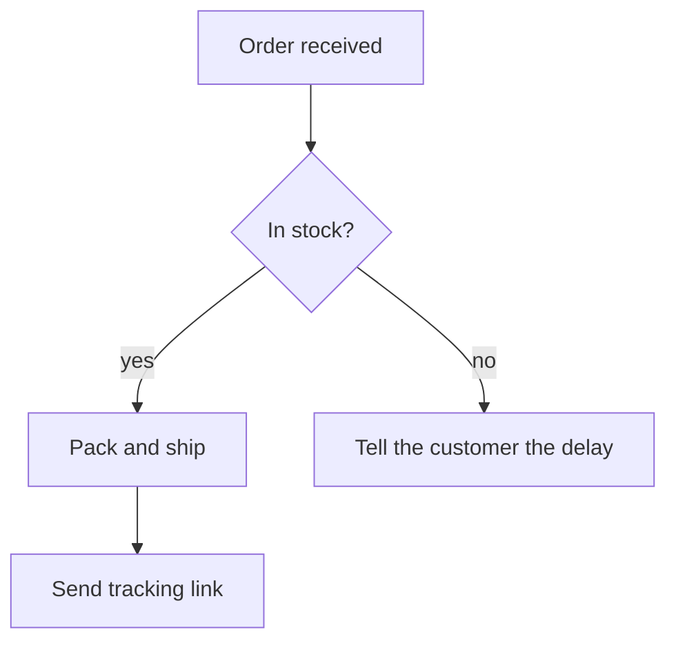

> Adapted from CLI-Anything "cli-anything-mermaid" and "cli-anything-drawio" (© 2026 HKUDS CLI-Anything Team, Apache License 2.0). Modified for Sklubot (2026-11-22): the Python harnesses and the online mermaid.ink renderer removed (the diagram's content would be sent to a third party); diagrams drawn inside Sklubot pages or rendered on the bot's computer; draw.io files written directly; translated into French. Updated 2026-11-25 (L115): the tools now come with the computer image (page_audit, sklubot-axe, mmdc).

# Diagrams

A diagram is worth it when it shows a structure faster than a list: steps with choices, who reports to whom, what happens when. Keep it to one idea, at most about 15 boxes; split it otherwise.

## Choose the kind

- **Process / decision**: Mermaid `flowchart TD` (top to bottom) or `LR` (left to right).
- **Who talks to whom over time** (customer, shop, supplier): `sequenceDiagram`.
- **Timeline / planning**: `timeline` or `gantt`.
- **Organisation chart or mind map**: `flowchart TD` or `mindmap`.
- **Customer journey**: `journey`.
- **A layout the owner wants to rearrange by hand**: a draw.io file.

## Mermaid, written well

- Short labels (3 to 5 words), the same verb form everywhere, ids without spaces.
- Decisions as `{question?}` with labelled yes/no arrows.
- No colour without meaning; if you colour, add a one-line legend.
- Text in the owner's language; accents are fine inside brackets.

## Show it

- **In a Sklubot page or artifact** (preferred, stays editable): include the Mermaid library from an allowed CDN at an exact version, for example ``, put the text in `<pre class="mermaid">…</pre>`, call `mermaid.initialize({ startOnLoad: true, theme: "neutral" })`, and also keep the Mermaid text under the drawing (a "Source" block) so it can be edited. Check light and dark and phone width (screen_view).
- **As an image file** (for a document, a slide or an email): render on your computer with Mermaid's own command-line renderer, `@mermaid-js/mermaid-cli`, already installed on your computer at a pinned version (it uses the computer's own Chromium, nothing goes online): `mmdc -i diagram.mmd -o diagram.svg` (or `.png -s 2` for a sharp picture) and look at the result.
- **Never** paste the diagram into an online rendering service (it would receive the content).

## draw.io file

When the owner wants to move boxes by hand, write a `.drawio` file (plain XML: `<mxfile><diagram><mxGraphModel><root>` with `mxCell` boxes having `vertex="1"` and a `geometry`, and arrows with `edge="1" source="…" target="…"`), save it in your library (file_save) and say it opens in the free draw.io desktop app or at app.diagrams.net (which edits files locally in the browser). Keep ids stable so later edits are easy.

## Check

Look at the rendered diagram before sending: nothing overlaps, arrows go the right way, text readable at phone width, every box from the request is there.
